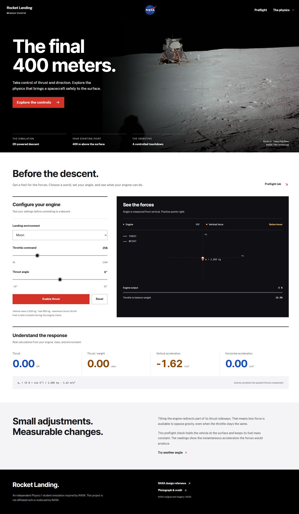
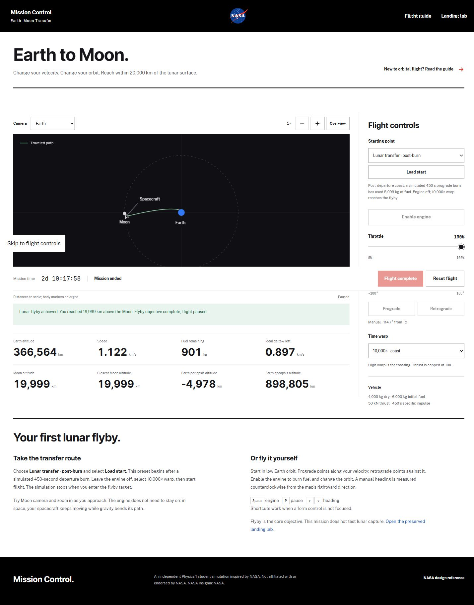

# Mission Control: Earth–Moon Transfer

A Physics 1 browser simulation. The default mission now begins on an Earth launch pad, climbs through atmospheric layers, achieves a calculated400km orbit, performs its departure burn and continues to guided lunar touchdown. Stage mass, fuel and drag are calculated throughout. The original post-departure landing, flyby and Earth-orbit experiments remain available. Classroom hardware checks, report interpretation and team reflection remain pending.

The browser opens the NASA-style orbital mission. The preserved landing preflight is available at ?view=landing. The existing landing engine remains available as a fallback; its equations and validation are retained below.

## Earth–Moon physics

See [orbital equations and API](docs/orbital-physics.md), [build roadmap](docs/earth-moon-roadmap.md), [report outline](docs/report-outline.md), and [rubric coverage](docs/rubric-checklist.md). Run npm test for both engines. The orbital tests print numerical radius, energy, period and rocket-equation comparisons for Verlet and RK4. The engine validation is [orbital-validation.txt](docs/orbital-validation.txt); the full 37-test checkpoint result is [checkpoint2-validation.txt](docs/checkpoint2-validation.txt).

The model uses SI units, optional rotating-atmosphere drag and staged Earth launch, Earth-centered differential lunar gravity, a circular moving Moon, variable-mass thrust, fuel-exhaustion splitting, bounded numerical substeps, and osculating Earth-orbit diagnostics. The flyby vehicle's initial ideal delta-v is 4.044 km/s; the dedicated landing vehicle begins with 16,000 kg fuel and 100 kN thrust. A finite-burn flyby preset is verified end-to-end. See [flight controls and demo](docs/flight-controls.md) and [preset recipe](docs/flyby-preset.md).

## Run the project

Install packages with npm install, then run npm run dev and open Vite's local URL. The default **Earth launch → Moon** starts paused on the pad; select **Launch mission**. Automatic guidance handles atmosphere climb, staging,400km orbit, the actual450s departure and lunar landing. Time warp changes by flight phase. Use Enter fullscreen or Expand view for presentation.

For shorter runs, load **Moon landing · post-departure**, **Moon flyby · coast** or **Earth orbit · practice**. See [full launch model/demo](docs/earth-launch.md) and [verification](docs/earth-launch-validation.txt). The earlier static preflight lab remains at ?view=landing.

Run npm run build to create a production build in dist, or npm run preview to inspect it.

## Run the physics tests

Use Node.js 20.19+ or 22.12+ (Node 24 is used for validation):

    npm test

The test script uses Node's built-in test runner. It covers orbital physics, mission events and the preserved landing engine. The orbital mission is playable; the earlier landing view remains a static preflight lab.

## Preserved landing engine: coordinate system and controls

- x is horizontal position in meters, positive right.
- y is altitude in meters, positive upward. Ground contact is y = 0.
- vx and vy are velocities in meters per second.
- Angle is in radians from vertical; a positive angle points thrust to the right.
- Throttle is clamped to 0 through 1. Angle is directly controlled; rotational torque is not modeled.
- The default step is 1/120 second. The later game loop will use a fixed-step accumulator.

The default run begins 400 m above the pad, descending at 25 m/s. The default planet is the Moon. config.js also defines Mars and Earth.

## Physics and algorithm

Each step first computes mass m = dryMass + fuelMass and thrust T = throttle * maxThrust while fuel remains. Thrust components are Tx = T sin(angle) and Ty = T cos(angle).

Atmospheric density is rho(y) = rho0 exp(-max(y, 0) / H). The drag force vector is Fdrag = -0.5 rho Cd A |v| v, so it opposes the velocity vector. The Moon has zero atmospheric density; drag can be disabled for comparison.

Newton's second law gives:

    ax = (Tx + Fdrag,x) / m
    ay = (Ty + Fdrag,y) / m - g

Propellant burn rate is mdot = T / (Isp g0), with standard gravity g0 = 9.81 m/s^2. A step is split at fuel exhaustion so thrust stops during that step, rather than continuing with empty tanks.

The default integrator is semi-implicit Euler: update velocity using acceleration, then position using the new velocity. RK4 is an alternative for comparison. The step function does not mutate its input state. If a step crosses ground level, impact state is linearly interpolated to y = 0.

Landing requires contact within the pad width, |vx| <= 2 m/s, and |vy| <= 4 m/s. These are mission success rules, not universal physical constants.

The energy readout calculates KE = 0.5 m (vx^2 + vy^2), PE = m g y, and their sum. Mechanical energy is not conserved during powered flight or drag because the engine exchanges energy with fuel and exhaust and drag dissipates energy. Cumulative drag loss is tracked separately.

## Validation

The automated tests cover analytical free fall, hover thrust, angled thrust, drag direction, fuel burn and exhaustion, RK4 comparison, ground contact, landing limits, energy, and state immutability.

For a three-second Moon free fall starting at y = 400 m and vy = -25 m/s, with thrust and drag absent:

| Method | Final altitude | Final vertical speed | Altitude error |
| --- | ---: | ---: | ---: |
| Analytical equation | 317.710000 m | -29.860000 m/s | 0 m |
| Semi-implicit Euler, dt = 1/120 s | 317.689750 m | -29.860000 m/s | 0.020250 m |
| RK4, dt = 1/120 s | 317.710000 m | -29.860000 m/s | less than 0.000001 m |

## Current limitations and planned work

Gravity and specific impulse are constant per planet/run. The atmosphere is simplified and terrain is flat. The rocket is treated as a point for touchdown, with no tilt or rotational dynamics. Impact interpolation is linear within the final time step. Chemical fuel energy, exhaust energy, and impact force are not modeled.

The interface uses Vite 8 and Tailwind CSS 4 through the official Vite plugin. Theme tokens live in the @theme block in src/styles.css; no legacy Tailwind or PostCSS configuration file is needed. JetBrains Mono is bundled with its SIL Open Font License for offline measurements.

Checkpoint 4 adds a recognizable rocket with thrust-driven exhaust, NASA Earth/Moon imagery, an illustrative space backdrop, flight/map views and fullscreen or expanded presentation with hideable controls. See [presentation guide](docs/checkpoint4-guide.md), [visual brief](docs/checkpoint4-visual-brief.md) and [asset provenance](docs/flight-assets.md). Artwork is enlarged and background planets are illustrative. The landing extension reuses the orbital model and moving-surface collision detector; it adds a dedicated vehicle and Moon-relative guidance. Classroom laptop/projector checks and team rehearsal remain pending. A 3D view, Mars transfer and Python validation backend remain deferred.

## Preflight interface preview

Setup references: [Vite guide](https://vite.dev/guide/) and [Tailwind CSS Vite installation](https://tailwindcss.com/docs/installation/using-vite).

The current design follows nasa.gov with locally bundled Inter and Public Sans fonts, the NASA insignia, and a credited Apollo 11 photograph. See docs/nasa-redesign.md for source URLs and attribution. It remains an independent student project, not affiliated with or endorsed by NASA.

## Orbital flight preview (checkpoint 2)

## Prediction, setup and analysis

See [checkpoint 3 guide](docs/checkpoint3-guide.md), [report draft](docs/checkpoint3-report-draft.md), [validation output](docs/checkpoint3-validation.txt), and [checkpoint 4 visual brief](docs/checkpoint4-visual-brief.md). Below the flight view, inspect live forces, configure a new LEO vehicle, save up to three runs, compare graphs, and download SI CSV or a Markdown report. A dashed amber engine-off forecast is separate from the green traveled path. Postburn reports start after departure. The flyby coast consumes no additional fuel; landing guidance burns fuel and records incoming touchdown evidence.

## Illustrated flight and presentation

Use **Enter fullscreen** for the flight scene or **Expand view** for the same presentation inside the browser window. Native fullscreen falls back to expanded view when unavailable. **H** hides/restores secondary controls; pause/resume and exit remain reachable. **P** pauses/resumes, **F** enters/exits presentation, and **Escape** exits. Entering, changing view and exiting preserve the mission state; pause first when comparing readings.

**Restart Moon mission** intentionally loads and starts a new guided Earth launch and lunar landing, saving the previous meaningful segment. To demonstrate a manual burn, load low Earth orbit instead. Return from presentation to inspect forces, forecast, charts and exports below the scene. See the [checkpoint 4 guide](docs/checkpoint4-guide.md) for the rehearsal sequence and current verification evidence.

All six flight images are bundled locally (about8MB total, including generated lunar surface and Earth launch scenery), with production credits at [flight credits](public/flight/credits.md), served as `/flight/credits.md`. The project is independent and is not affiliated with or endorsed by NASA. The earlier checkpoint 4 passed 64 tests and the production build; current landing evidence is documented in docs/lunar-landing.md. The visual reviewer scored all three requested fixes resolved; classroom rehearsal and final student submission work remain. See docs/checkpoint4-review.md.

## Full Earth launch delivered —2026-10-19

[Earth launch model/demo](docs/earth-launch.md) documents vehicle stages, atmosphere, guidance, launch window and limitations. Current113 tests and production build pass. A real production browser run reached Moon touchdown at2d14:31:34 with411kg fuel and0.30m/s incoming speed. Records/export distinguish burned fuel from discarded upper-stage reserve. NASA five-layer labels are approximate;100km is a conventional space boundary within the thermosphere. The simulation remains2D with idealized engines and point contact. Final school hardware rehearsal and student report/reflection remain team work.
